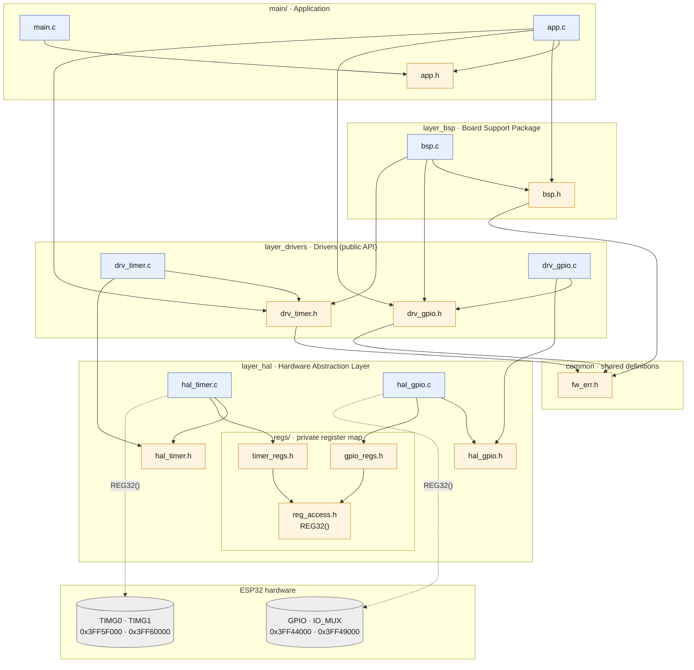

# U2 Laboratorio · Layered Bare-Metal Firmware for ESP32
 
Bare-metal firmware for the ESP32 built on ESP-IDF, accessing the GPIO, IO_MUX and Timer Group
peripherals directly through their registers (no ESP-IDF GPIO/timer drivers). The code is split
into layers so that the application never touches a register or a pin number directly.
 
Software Embebido · Instituto Tecnológico del Estado de Chihuahua (ITECH)
 
---
 
## Architecture
 
Each box is an ESP-IDF component (a layer). Arrows are `#include` dependencies between files;
dashed arrows are direct access to the chip's hardware.
 

 
Blue boxes are source files (`.c`), orange boxes are headers (`.h`).
 
### Layers
 
| Layer | Responsibility | Touches registers? |
|---|---|---|
| **App** (`main/`) | Example application: the APAGADO / STANDBY / RUNNING state machine | No |
| **BSP** (`layer_bsp`) | Knows the board: which pin is each LED and button, and initializes them | No |
| **Drivers** (`layer_drivers`) | General API: validates parameters, returns error codes, decides the order of operations | No |
| **HAL** (`layer_hal`) | One small function per hardware operation, no validation | Yes, only here |
| **regs/** (inside HAL) | Base addresses, offsets, bits and masks from the ESP32 TRM v4.6 | — |
| **common** | Project-wide error type and codes (`fw_err_t`), currently backed by ESP-IDF's `esp_err_t` | No |
 
Rule of thumb: *how it is done on this chip* goes in the HAL; *whether it should be done* goes in
the driver.
 
### Dependency rules (enforced by CMake)
 
```
main           ──REQUIRES──▶  layer_bsp, layer_drivers, common
layer_bsp      ──REQUIRES──▶  common          ──PRIV_REQUIRES──▶  layer_drivers
layer_drivers  ──REQUIRES──▶  common          ──PRIV_REQUIRES──▶  layer_hal
layer_hal      ──PRIV_INCLUDE_DIRS──▶  regs/
common         ──REQUIRES──▶  esp_common (ESP-IDF)
```
 
Because of `PRIV_REQUIRES` and `PRIV_INCLUDE_DIRS`, a file can only include headers from the layer
directly below it. Including `gpio_regs.h` or `hal_gpio.h` from the application fails at compile time.
`common` is required publicly (`REQUIRES`) because `fw_err_t` appears in the public headers of the
drivers and the BSP.
 
---
 
## Repository structure
 
```
.
├── CMakeLists.txt
├── components/
│   ├── common/
│   │   └── include/        fw_err.h
│   ├── layer_hal/
│   │   ├── hal_gpio.c
│   │   ├── hal_timer.c
│   │   ├── include/        hal_gpio.h, hal_timer.h
│   │   └── regs/           reg_access.h, gpio_regs.h, timer_regs.h (private)
│   ├── layer_drivers/
│   │   ├── drv_gpio.c
│   │   ├── drv_timer.c
│   │   └── include/        drv_gpio.h, drv_timer.h
│   └── layer_bsp/
│       ├── bsp.c
│       └── include/        bsp.h
└── main/
    ├── main.c
    ├── app.c
    └── app.h
```
 
---
 
## Build
 
Requires ESP-IDF (VS Code ESP-IDF extension or `idf.py`), target `esp32`.
 
```bash
idf.py set-target esp32
idf.py build flash monitor
```
 
---
 
## References
 
- Espressif Systems, *ESP32 Technical Reference Manual*, v4.6 — Ch. 4 (IO_MUX and GPIO Matrix), Ch. 18 (Timer Group)
